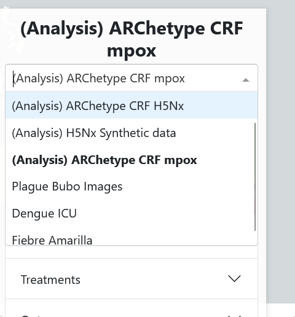
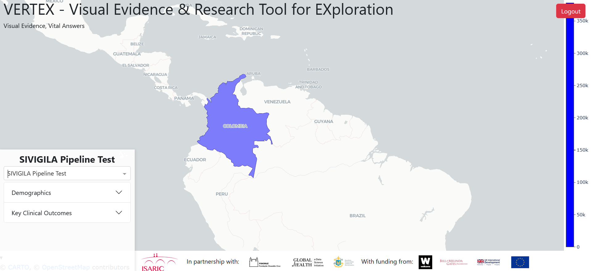
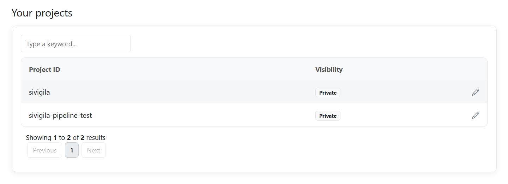
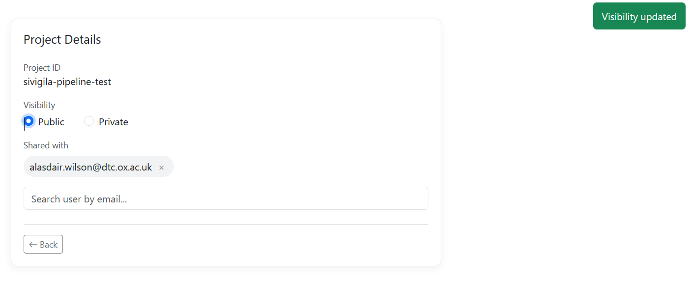
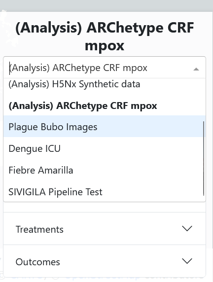

.. _adding-a-project:

Adding a project to VERTEX
--------------------------

This page documents the full pipeline for publishing a new project to the ISARIC VERTEX deployment at `vertex.isaric.org <https://vertex.isaric.org>`_: from creating the project folder in the private `VERTEX-projects <https://github.com/ISARICResearch/VERTEX-projects>`_ repository, through the automated server sync, to managing who can see the project via `account.isaric.org <https://account.isaric.org>`_.

.. _pipeline-overview:

Pipeline overview
~~~~~~~~~~~~~~~~~

.. code:: text

   ┌─────────────────────┐   PR + merge    ┌──────────────────────────┐
   │  VERTEX-projects    │ ──────────────▶│  main branch             │
   └─────────────────────┘                 └────────────┬─────────────┘
                                                        │  hourly cron
                                                        ▼
                                           ┌──────────────────────────┐
                                           │  EC2: git pull to        │
                                           │  /opt/vertex-projects    │
                                           │  + project ingestion     │
                                           └────────────┬─────────────┘
                                                        │  inserts project + owner link
                                                        ▼
                                           ┌──────────────────────────┐
                                           │  RDS access database     │
                                           │  (projects, users,       │
                                           │   user_project_mapping)  │
                                           └──────┬────────────┬──────┘
                                                  │            │
                                     access managed via       visibility on
                                                  ▼            ▼
                                     account.isaric.org   vertex.isaric.org

Project **files** (dashboard data, figures, metadata) are served from the synced copy of the VERTEX-projects repository on the VERTEX server.
Project **access rights** (owner, public/private, shared users) live in the RDS database and are managed through the account webapp.
The config file (:file:`config_file.json`) in the repository only seeds the database entry the first time the project is ingested — after that, access is controlled entirely from `account.isaric.org <https://account.isaric.org>`_.

.. _generate-project-folder:

1. Generate your project
~~~~~~~~~~~~~~~~~~~~~~~~

Each project is a top-level folder in the VERTEX-projects repository containing the **public outputs** of a VERTEX analysis — aggregated data and prebuilt figure files only, never raw data.

You do not write this folder by hand. VERTEX generates it from your analysis project — the simplest way is the :doc:`CLI <cli>`:

.. code:: shell

   vertex-cli descriptive-analytics --project-path path/to/your/analysis-project/

This writes the complete static project folder (and PNG exports of every figure) to the project's ``outputs_path`` (:file:`outputs/` by default).

The generated folder is what you commit to VERTEX-projects as a new top-level directory:

.. code:: text

   My_Project/
   ├── config_file.json        # generated: project identity + initial access settings
   ├── dashboard_data.csv      # aggregated/summary data for the dashboard
   ├── dashboard_metadata.json # insight panel layout (figures, tables, filters)
   └── <panel folders>/        # one folder per insight panel, containing figure data

.. _project-config-file:

:file:`config_file.json`
^^^^^^^^^^^^^^^^^^^^^^^^

Review the generated config before committing — in particular ``project_id`` (must be unique across VERTEX-projects), ``project_owner``, and ``is_public``:

.. code:: json

   {
     "project_name": "SIVIGILA Pipeline Test",
     "project_owner": "owner@example.org",
     "project_id": "sivigila-pipeline-test",
     "map_layout_center_latitude": 6,
     "map_layout_center_longitude": -75,
     "map_layout_zoom": 2.5,
     "save_outputs": false,
     "is_public": false
   }

This example is a private test project, hence ``"is_public": false`` — omit the field entirely to get the default of ``true`` (see the table below).

Every pull request is checked automatically: the config is validated against :file:`config_file.schema.json` in the root of the VERTEX-projects repository, and the ``project_id`` is checked for uniqueness against all existing and retired projects.

.. list-table::
   :header-rows: 1
   :widths: 15 15 70

   * - Field
     - Required
     - Notes
   * - ``project_id``
     - yes
     - Unique, stable, kebab-case identifier (lower-cased, hyphen-separated, e.g. ``my-project-id``). This is the primary key used to match the project against the access database (``vertex_id`` column). It must not clash with any existing project and should never be changed after the first ingestion.
   * - ``project_name``
     - recommended
     - Display name shown in VERTEX. Defaults to the folder name if omitted.
   * - ``project_owner``
     - yes (for ingestion)
     - Email address of the owner. **The owner must already have an account on** `account.isaric.org <https://account.isaric.org>`_ — ingestion of a new project fails if this email has no user record, and retries on the next hourly run.
   * - ``is_public``
     - no (defaults to ``true``)
     - Initial visibility. ``false`` means only the owner and explicitly shared users can see the project. **Only read at first ingestion** — change visibility afterwards via the account webapp, not by editing this file.
   * - ``map_layout_*``
     - no
     - Initial map viewport for map panels.

.. _project-submit:

2. Deploying your project
~~~~~~~~~~~~~~~~~~~~~~~~~

To deploy your project to VERTEX submit the project folder, preferably as a single ZIP or archive file containing all required files, to the ISARIC data team via email: :email:`data@isaric.org`. The data team will ensure that the project is deployed to VERTEX.

There is a future enhancement being considered that would allows users to directly upload their project via a suitably secure cloud storage solution, which will trigger an automated deployment to VERTEX.

.. _project-view-vertex:

3. View your project in VERTEX
~~~~~~~~~~~~~~~~~~~~~~~~~~~~~~

On `vertex.isaric.org <https://vertex.isaric.org>`_:

- **Public** projects are visible to everyone, logged in or not.
- **Private** projects are visible only to the owner and shared users, owners will always be able to see the project after logging in with the same account used on account.isaric.org.

Because this project was ingested with ``is_public: false``, it does not appear in the project selector for anyone else — the other (public) projects are listed, but the new one is absent:

Logged in as the owner, the project is available and opens like any other dashboard:

.. _project-manage-access:

4. Manage access from the ISARIC Accounts app
~~~~~~~~~~~~~~~~~~~~~~~~~~~~~~~~~~~~~~~~~~~~~

Once ingested, the project appears for the owner on `account.isaric.org <https://account.isaric.org>`_ under **Your projects**, with its current visibility:

Opening a project's details page (pencil icon) lets the owner:

- **Share with individual users** — search accounts by email and add or remove them. Shared users can open the project in VERTEX while it stays private to everyone else.
- **Toggle visibility** between Public and Private.

Here the project has been shared with a second account and then switched to Public:

Access checks happen at page load: there is no extra sync delay, because both applications read the same access database.
After the switch to Public above, the project immediately shows up in the VERTEX project selector without logging in:

.. _removing-a-project:

5. Removing a project
~~~~~~~~~~~~~~~~~~~~~

For project removal please contact the ISARIC data team at :email:`data@isaric.org`. As with project deployment, there may be a future enhancement to allow users to do this in a more convenient way.
