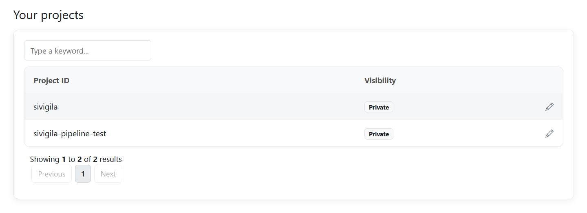

.. _adding-a-project:

User Guide
----------

.. _create-project-folder:

1. Create your project
~~~~~~~~~~~~~~~~~~~~~~

A VERTEX project is folder containing the **public outputs** of a VERTEX analysis project, specifically, aggregated data and prebuilt figure files only, never raw data.

You do not write this folder by hand. VERTEX generates it from your analysis project — the simplest way is to ``pip`` install the VERTEX project and run the :ref:`descriptive-analytics CLI <cli-descriptive-analytics>`:

.. code:: shell

   vertex-cli descriptive-analytics --project-path path/to/your/analysis-project/

This writes the complete static project folder (and PNG exports of every figure) to the project's ``outputs_path`` (:file:`outputs/` by default).

The generated folder structure should like the listing below:

.. code:: text

   My_Project/
   ├── config_file.json        # generated: project identity + initial access settings
   ├── dashboard_data.csv      # aggregated/summary data for the dashboard
   ├── dashboard_metadata.json # insight panel layout (figures, tables, filters)
   └── <panel folders>/        # one folder per insight panel, containing figure data

If it doesn't, or you notice any anomalies or missing files, either re-rerun ``descriptive-analytics`` or contact the ISARIC data team (:email:`data@isaric.org`).

.. _project-config-file:

:file:`config_file.json`
^^^^^^^^^^^^^^^^^^^^^^^^

Before submitting, review the generated folder, including the config. JSON. In particular ``project_id`` must be unique and not equal to that of any existing or archived VERTEX project - contact the ISARIC data team if in doubt. Also, ``project_owner`` must be a valid email, and ``is_public`` should be ``true`` or ``false`` depending on whether the project is public or private. An example is given below for a SIVIGILA test project:

.. code:: json

   {
     "project_name": "SIVIGILA Test",
     "project_owner": "owner@example.org",
     "project_id": "sivigila-pipeline-test",
     "map_layout_center_latitude": 6,
     "map_layout_center_longitude": -75,
     "map_layout_zoom": 2.5,
     "save_outputs": false,
     "is_public": false
   }

.. _project-submit:

2. Submitting your project
~~~~~~~~~~~~~~~~~~~~~~~~~~

Submit the project folder, preferably as a single ZIP or archive file containing all required files, to the ISARIC data team via email (:email:`data@isaric.org`) for review. Following a satisfactory review the team will deploy the project to VERTEX. If there are any further changes required or other problems you will be contacted by the team.

This process may be automated in the future.

.. _project-view-vertex:

3. View your project in VERTEX
~~~~~~~~~~~~~~~~~~~~~~~~~~~~~~

Check that the project is visible at `vertex.isaric.org <https://vertex.isaric.org>`_:

- **public** projects are visible to everyone, logged in or not.
- **private** projects are visible only to the owner and shared users, owners will always be able to see the project after logging in with the same account used on the ISARIC Accounts service (`account.isaric.org <https://account.isaric.org>`_).

.. _project-manage-access:

4. Manage your projects on ISARIC Accounts
~~~~~~~~~~~~~~~~~~~~~~~~~~~~~~~~~~~~~~~~~~

Your projects can be viewed and managed on the Accounts service: an example logged-in is given below:

Opening a project's details page (pencil icon) lets you:

- **Share the project with individual users** — search accounts by email and add or remove them. Shared users can open the project in VERTEX while it stays private to everyone else.
- **Toggle visibility** between public and private.

.. _removing-a-project:

5. Removing a project
~~~~~~~~~~~~~~~~~~~~~

To remove a project please contact the ISARIC data team at :email:`data@isaric.org`. As with project deployment, this process may be automated in the future.
