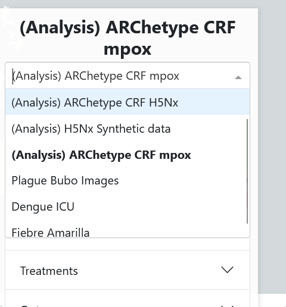
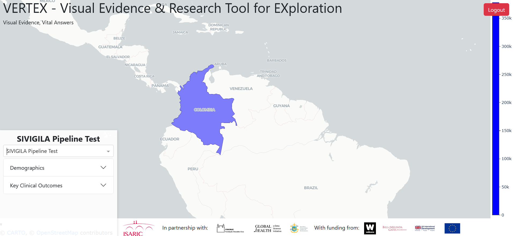
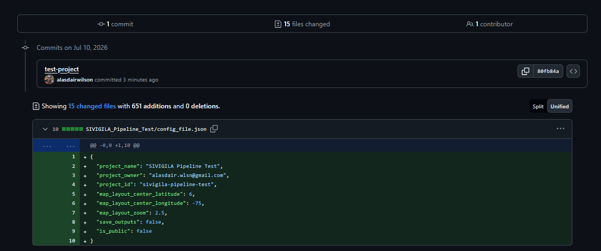
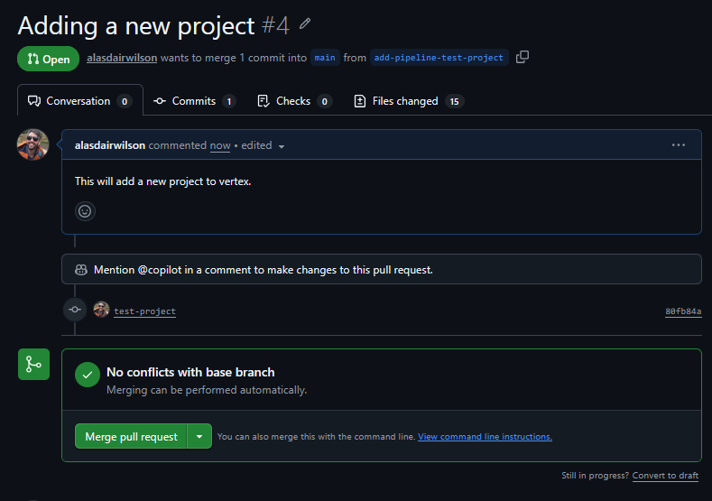
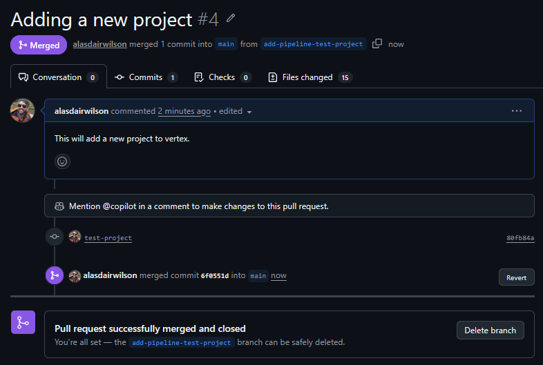
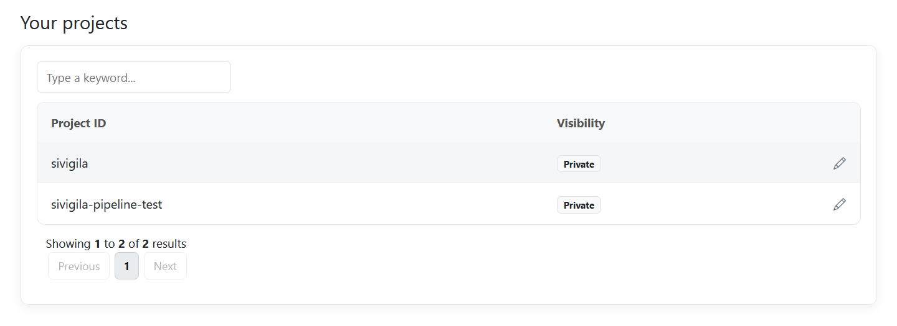
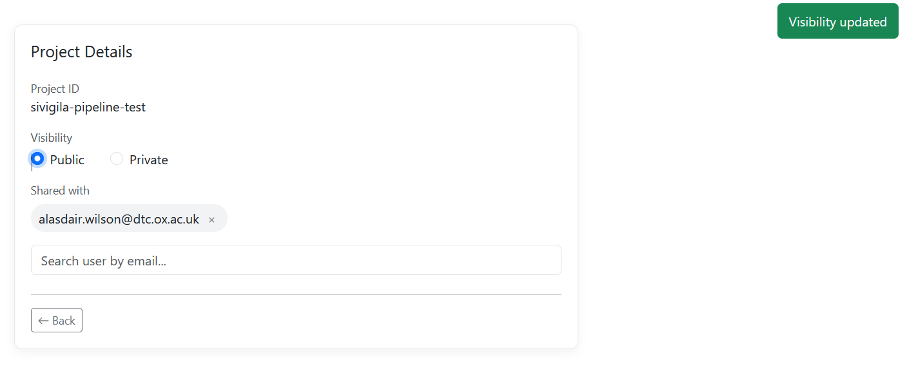
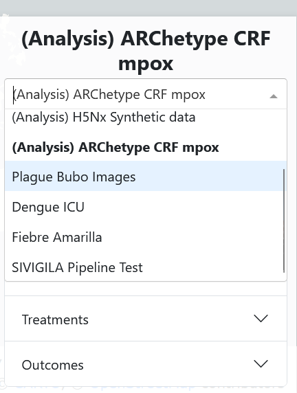

.. _maintainer-notes:

Notes for Maintainers
---------------------

This page is aimed at VERTEX maintainers and describes the full deployment pipeline for publishing a new project to VERTEX, starting with an overview.

.. _maintainer-pipeline-overview:

Pipeline overview
~~~~~~~~~~~~~~~~~

.. code:: text

   ┌─────────────────────┐   PR + merge    ┌──────────────────────────┐
   │  VERTEX-projects    │ ──────────────▶│  main branch             │
   └─────────────────────┘                 └────────────┬─────────────┘
                                                        │  hourly cron
                                                        ▼
                                           ┌──────────────────────────┐
                                           │  EC2: git pull to        │
                                           │  /opt/vertex-projects    │
                                           │  + project ingestion     │
                                           └────────────┬─────────────┘
                                                        │  inserts project + owner link
                                                        ▼
                                           ┌──────────────────────────┐
                                           │  RDS access database     │
                                           │  (projects, users,       │
                                           │   user_project_mapping)  │
                                           └──────┬────────────┬──────┘
                                                  │            │
                                     access managed via       visibility on
                                                  ▼            ▼
                                     account.isaric.org   vertex.isaric.org

The key elements of the pipeline are:

- **VERTEX-projects** - this is a private repository accessible only to key VERTEX maintainers and owners, storing user projects, organised in folders, that are then deployed to VERTEX via pull requests (PRs).
- The project **folder** - each folder contains dashboard data, figure, and metadata files, and is served from the synced copy of the VERTEX-projects repo on the VERTEX server. The folder is originally generated by a user, typically, the project owner, and submitted to the ISARIC data team, typically, by email (:email:`data@isaric.org`).
- Project **configuration** - this is defined in the project's :file:`config_file.json` file, and seeds the database entry the first time the project is ingested, after which access is controlled entirely from the ISARIC Accounts service (`account.isaric.org <https://account.isaric.org>`_).
- Project **access rights** - these define the project owner, project visibility (public/private), shared users, and is stored in an AWS RDS database that is managed via the Accounts service.

These are described in more detail below.

.. _maintainer-project-folder-and-configuration:

A project folder should have the following structure:

.. code:: text

   My_Project/
   ├── config_file.json        # generated: project identity + initial access settings
   ├── dashboard_data.csv      # aggregated/summary data for the dashboard
   ├── dashboard_metadata.json # insight panel layout (figures, tables, filters)
   └── <panel folders>/        # one folder per insight panel, containing figure data

The config. JSON is key, and a valid example for a private test project is given below as a guide.

.. code:: json

   {
     "project_name": "SIVIGILA Pipeline Test",
     "project_owner": "owner@example.org",
     "project_id": "sivigila-pipeline-test",
     "map_layout_center_latitude": 6,
     "map_layout_center_longitude": -75,
     "map_layout_zoom": 2.5,
     "save_outputs": false,
     "is_public": false
   }

The config. data is validated against a template config. JSON, :file:`config_file.schema.json`, located in the root of VERTEX-projects. The validation is summarised in the below.

.. list-table::
   :header-rows: 1
   :widths: 15 15 70

   * - Field
     - Required
     - Notes
   * - ``project_id``
     - yes
     - Unique, stable, kebab-case identifier (lower-cased, hyphen-separated, e.g. ``my-project-id``). This is the primary key used to match the project against the access database (``vertex_id`` column). It must not clash with any existing project and should never be changed after the first ingestion.
   * - ``project_name``
     - recommended
     - Display name shown in VERTEX. Defaults to the folder name if omitted.
   * - ``project_owner``
     - yes (for ingestion)
     - Email address of the owner. **The owner must already have an account on** the Accounts service — ingestion of a new project fails if this email has no user record, and retries on the next hourly run.
   * - ``is_public``
     - no (defaults to ``true``)
     - Initial visibility. ``false`` means only the owner and explicitly shared users can see the project. **Only read at first ingestion** — change visibility afterwards via Accounts, not by editing this file.
   * - ``map_layout_*``
     - no
     - Initial map viewport for map panels.

A project with ``is_public: false`` in the config. does not appear in the project selector for anyone else — the other (public) projects are listed, but the new one is absent:

But logged in as the owner, the project is available and opens like any other dashboard:

Commit the new folder on a branch and open a PR against ``main`` in VERTEX-projects. The diff should contain only the new project folder — here an example diff of the config file plus the dashboard data and figure files:

Once the PR is merged, no further manual action is needed — the server picks the change up automatically.

.. _maintainer-project-sync-ingestion:

3. Automated server sync and ingestion
~~~~~~~~~~~~~~~~~~~~~~~~~~~~~~~~~~~~~~

An hourly cron job on the VERTEX EC2 instance (at \*:00) does two things:

1. **Sync** — pulls the ``main`` branch of VERTEX-projects into :file:`/opt/vertex-projects` using a read-only deploy key (:file:`scripts/sync_projects_repo.sh` in this repository).
2. **Ingest** — runs :command:`python -m vertex.project_ingestion` inside the running VERTEX container, which scans every project folder and, for each ``project_id`` not yet in the database:

   - looks up the ``project_owner`` email in the ``users`` table (fails for this project if the account does not exist yet — it will be retried every hour),
   - inserts a row into ``projects`` (``vertex_id``, ``owner_id``, ``is_public``), and
   - links the owner in ``user_project_mapping``.

Ingestion is **insert-only and idempotent**: projects already in the database are left untouched, so ownership, visibility, and sharing changes made in the account webapp are never overwritten by subsequent syncs.

Both steps log to :file:`/var/log/vertex-projects-sync.log` on the instance. A successful run for a new project looks like:

.. code:: text

   [2026-07-10T18:00:01+00:00] Sync started: repo=git@github.com:ISARICResearch/VERTEX-projects.git branch=main dir=/opt/vertex-projects
   [2026-07-10T18:00:03+00:00] Sync finished successfully
   2026-07-10 18:00:05 [INFO] __main__: Static project ingestion summary: seen=5 inserted=1 existing=1 failed=3 owner_links_inserted=1 ...

(``inserted=1`` / ``owner_links_inserted=1`` is the new project; ``failed=3`` here are pre-existing projects whose owner has no account yet; see the troubleshooting table below.)

- The cron definition lives at :file:`/etc/cron.d/vertex-projects-sync` on the instance and is installed by :file:`scripts/install_projects_sync_cron.sh` in this repository.
- To trigger a sync immediately instead of waiting for the top of the hour (via SSM) run the following command (with ``sudo`` if necessary):

  .. code:: shell

     /usr/local/bin/vertex-sync-projects.sh
     docker exec isaric-vertex python -m vertex.project_ingestion --projects-dir /opt/vertex-projects

- Some common ingestion errors, causes and possible fixes are summarised below (this is **not** an exhaustive listing):

  .. list-table::
     :header-rows: 1
     :widths: 40 30 30

     * - Error
       - Cause
       - Fix
     * - ``owner user does not exist for <email>``
       - ``project_owner`` has no account
       - Owner signs up at account.isaric.org; ingestion retries hourly
     * - ``config_file.json is missing project_owner``
       - Field absent/empty
       - Add the field and merge a fix
     * - ``Skipping folder without config_file.json``
       - Folder has no config
       - Add a config file (folders without one are ignored, not errors)

.. _maintainer-project-manage-access:

. Manage projects from ISARIC Accounts
~~~~~~~~~~~~~~~~~~~~~~~~~~~~~~~~~~~~~~

Once ingested, the project appears for the owner on `account.isaric.org <https://account.isaric.org>`_ under **Your projects**, with its current visibility:

Opening a project's details page (pencil icon) lets the owner:

- **Share with individual users** — search accounts by email and add or remove them. Shared users can open the project in VERTEX while it stays private to everyone else.
- **Toggle visibility** between Public and Private.

Here the project has been shared with a second account and then switched to Public:

Access checks happen at page load: there is no extra sync delay, because both applications read the same access database.
After the switch to Public above, the project immediately shows up in the VERTEX project selector without logging in:

.. _maintainer-removing-a-project:

Removing a project
~~~~~~~~~~~~~~~~~~

**Do not simply delete the project folder.** Instead, create and merge a PR that empties that folder, leaving only a :file:`REMOVED.txt` marker that records the retired ``project_id``:

.. code:: text

   My_Project/
   └── REMOVED.txt

with contents along the lines of:

.. code:: text

   Project "My Project" (project_id: my-project) has been removed from VERTEX-projects.
   This folder name and project_id are retired and must not be reused.

A folder without a :file:`config_file.json` is ignored by both VERTEX and the project ingestion script, so that the project disappears from VERTEX at the next hourly sync.

A maintainer should then delete the project's ``user_project_mapping`` rows and its ``projects`` row (matched on ``vertex_id``) from the access database. This removes the project from the Accounts DB and guarantees no new project can ever inherit the removed project's owner, visibility, or shared users.

The retired folder is the permanent record that its name and ``project_id`` are taken — the ID only existed in the deleted :file:`config_file.json`, hence writing it into :file:`REMOVED.txt` for posterity. Neither should be reused: VERTEX share links identify projects as ``?project=<project_id>``, but fall back to folder, so a new project reusing either would capture links to the removed project.

Reviewers of PRs adding new projects should check the new ID against the retired folders.
